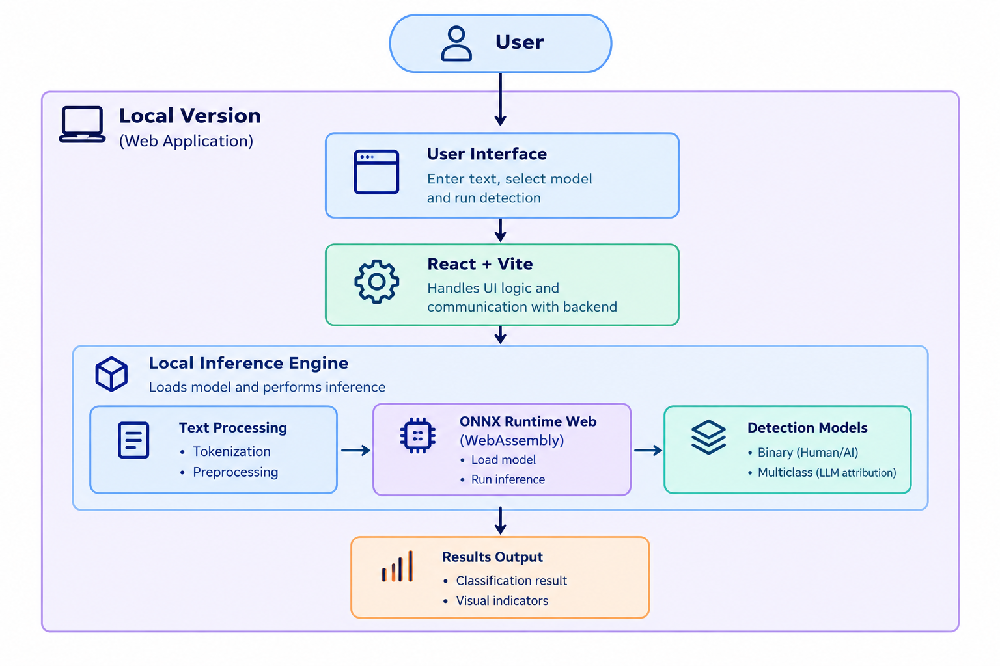
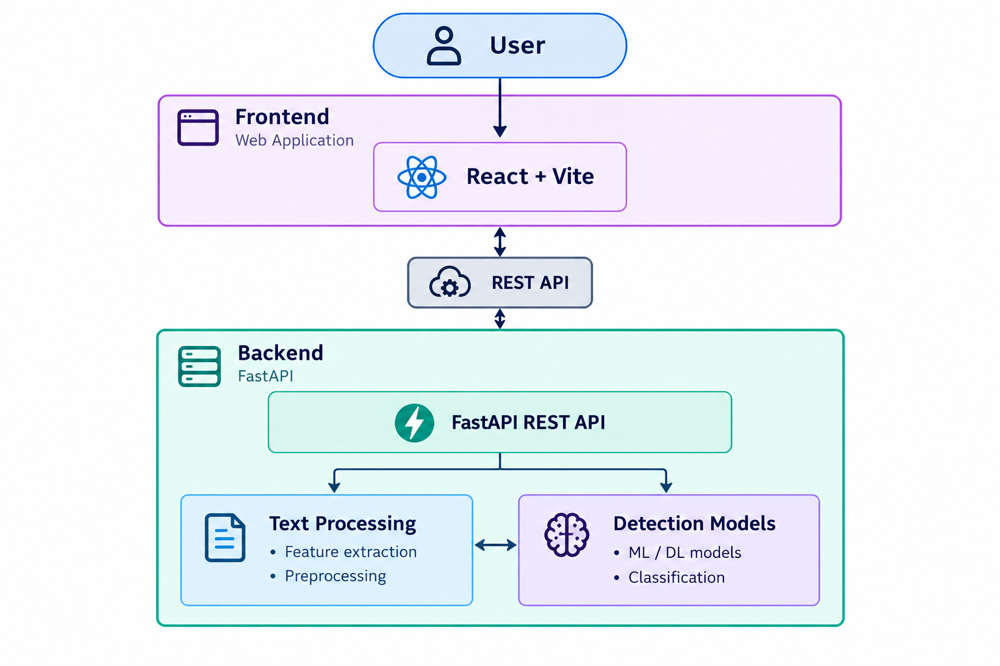

# AIDext2-Frontend

Frontend application for **AIDext2**, a web-based AI-generated text detection platform.

## Overview

This repository contains the frontend of **AIDext2**, built with React and Vite.

The application provides an intuitive interface for AI-generated text detection using both:

- **Remote inference**, where requests are sent to the backend API.
- **Local inference**, where ONNX models run directly inside the browser using ONNX Runtime Web.

## Features

| Feature | Description |
|---------|-------------|
| **AI Text Detection** | Analyze text using machine learning models to determine whether it was written by a human or generated by AI. |
| **AI Model Attribution** | Identify which AI model most likely generated the analyzed text. |
| **Multi-Task Analysis** | Run binary AI detection and AI model attribution simultaneously, providing both results in a single analysis. |
| **File Upload** | Upload supported text files and analyze their content automatically. |
| **Dual Inference Modes** | Perform inference either remotely through the FastAPI backend or locally in the browser using ONNX Runtime Web. |
| **Confidence Visualization** | View prediction confidence through interactive gauges and probability scores. |
| **Chunk-Level Analysis** | Analyze long texts by splitting them into overlapping windows and highlighting AI, human, or hybrid segments. |
| **Configurable Windowing** | Choose between word-based and character-based sliding windows to compare different text segmentation approaches. |
| **Intuitive User Interface** | Navigate the application through a clean, user-friendly interface with clear explanations and visual feedback. |
| **Integrated Documentation** | Access built-in documentation covering the application, detection models, and usage instructions. |

## Technologies

| Category | Technologies |
|----------|--------------|
| **Frontend** | React, TypeScript, Vite |
| **Styling** | Tailwind CSS |
| **Routing** | React Router |
| **Machine Learning** | ONNX Runtime Web |
| **Charts & Visualization** | MUI X Charts |
| **Deployment** | GitHub Pages |

## Key Libraries

| Library | Purpose |
|---------|---------|
| [`onnxruntime-web`](https://onnxruntime.ai/docs/get-started/with-javascript/web.html) | Executes ONNX machine learning models directly in the browser. |
| [`compromise`](https://github.com/spencermountain/compromise) | Performs lightweight natural language processing for feature extraction. |
| [`text-readability`](https://www.npmjs.com/package/text-readability) | Computes readability metrics used during text analysis. |
| [`@bokuweb/zstd-wasm`](https://github.com/bokuweb/zstd-wasm) | Provides WebAssembly-based Zstandard compression for compression-based features. |

## Architecture

AIDext2 provides two inference modes: **Local Inference**, where the detection process is performed directly in the user's browser, and **Backend Inference**, where the frontend communicates with a remote FastAPI backend.

### Local Inference

In Local Inference mode, the complete detection pipeline runs within the user's browser. The React frontend receives the input text and passes it to the local inference engine, which performs the required text processing before executing the detection models through ONNX Runtime Web.

The models are executed locally using WebAssembly, meaning that the text does not need to be sent to the backend for prediction.



In Local Inference mode, the complete detection process is performed within
the user's browser. The user provides the text through the React interface,
which passes it to the local inference engine. The input is processed and
prepared for inference before being passed to the detection models through
ONNX Runtime Web. The models execute directly in the browser, and the
resulting predictions are returned to the frontend and presented to the user.


### Backend Inference

In Backend Inference mode, the React frontend communicates with the FastAPI backend through a REST API. The backend is responsible for processing the input and executing the detection models.



In Backend Inference mode, the frontend communicates with the FastAPI
backend through a REST API. The user provides the text through the React
interface, which sends the input to the backend. The FastAPI server performs
the required text processing and passes the processed input to the
appropriate detection model. The resulting prediction is then returned
through the REST API and presented by the frontend.

### Inference Mode Comparison

| Aspect | Local Inference | Backend Inference |
|--------|-----------------|-------------------|
| **Execution** | User's browser | Backend server |
| **Communication** | No request required for inference | REST API |
| **Text Processing** | Frontend | Backend |
| **Model Execution** | ONNX Runtime Web | FastAPI backend |
| **Machine Learning Models** | ONNX format | Backend format(joblib) |
| **Server Required** | No | Yes |
| **Text Sent to Backend** | No | Yes |

## Project Structure

```text
src/
├── assets/             # Static assets (images, icons, fonts)
├── components/         # Reusable UI components
├── context/            # React Context providers
├── features/           # Features 
├── inference/          # Browser-based model loading and inference  
├── pages/              # Application pages
├── services/           # API communication and utilities
├── utils/              # Helper functions
├── App.tsx
└── main.tsx
```
### Main Components

| Directory | Description |
|----------|-------------|
| `assets/` | Static assets used throughout the application. |
| `components/` | Reusable React components that compose the user interface. |
| `context/` | React Context providers for global state management. |
| `features/` | Contains the implementation of the feature extraction pipeline used for local inference. |
| `inference/` | Contains the browser-based inference pipeline, including model loading, input preparation, and prediction. |
| `pages/` | Main application pages and routing targets. |
| `services/` | Communication with the backend API and other application services. |
| `utils/` | General-purpose helper functions. |

## Getting Started

Follow the steps below to set up and run the AIDext2 Frontend locally.

### Prerequisites

Before getting started, ensure the following software is installed on your system:

- **Node.js** (v22 or later recommended)
- **npm** (included with Node.js)

You can verify your installation by running:

```bash
node --version
npm --version
```

---

### Installation

Clone the repository and install the required dependencies.

```bash
git clone https://github.com/AIDetx2/AIDetx2-Frontend.git
cd AIDext2-Frontend
npm install
```

---

### Environment Variables

Create a `.env` file in the project root and configure the backend URL.

```env
VITE_API_URL=http://localhost:8000
```

> **Note**
>
> The frontend supports two inference modes:
>
> - **Backend Inference** requires a valid `VITE_API_URL`.
> - **Local Inference** runs entirely in the browser using ONNX Runtime Web and does not require the backend for prediction.

---

### Running the Development Server

Start the Vite development server:

```bash
npm run dev
```

The application will be available at:

```text
http://localhost:5173
```

The development server supports **Hot Module Replacement (HMR)**, allowing changes to be reflected instantly during development.

---

### Building for Production

To build the application for production, run:

```bash
npm run build
```

This command builds the application and automatically deploys it to **GitHub Pages**.

> **Note:** No separate deployment command is required. The build process handles both building and deployment.

The compiled application will be generated inside the `dist/` directory.

---

### Previewing the Production Build

To preview the production build locally before deployment, run:

```bash
npm run preview
```

This serves the optimized build locally, allowing you to verify that everything behaves as expected before deployment.

## Deployment

The frontend is deployed using **GitHub Pages** and is automatically updated through GitHub Actions whenever changes are pushed to the main branch.

### Production

https://aidetx2.github.io/

### Build Command

```bash
npm run deploy
```


### Output Directory

```text
dist/
```

## License

This project is licensed under the GNU General Public License v3.0 or later (GPL-3.0-or-later). See the [LICENSE](LICENSE) file for details.